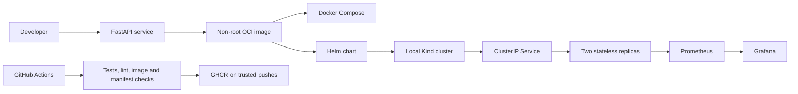

# PlatformOps Deployment Platform

PlatformOps is a local-first, production-minded example of the path from a tested Python service to an observable Kubernetes workload. Its first target is Docker and Kind on Linux; cloud infrastructure is deliberately outside the default workflow.

## Architecture



The app is stateless. Configuration is supplied through environment variables and a Kubernetes ConfigMap. The default service is ClusterIP; local access uses `kubectl port-forward`. The initial cluster path avoids an ingress controller so the first deployment stays small and repeatable. Helm is the deployment source of truth; raw manifests support inspection and Kustomize validation.

## Deployment lifecycle

`edit → lint/test → image build/scan → immutable SHA tag → deploy to local Kind → probe/metrics/rollout verification → scale/update/rollback`.
GHCR publishing is restricted to trusted branch or release workflows. No workflow provisions cloud infrastructure or deploys to production.

## Quick start

Prerequisites: Python 3.12+, Docker Engine with Compose, kubectl, Kind, Helm, and (for monitoring) cluster capacity for Prometheus/Grafana. The scripts fail early when a required CLI or context is unavailable.

```bash
python3 -m venv .venv && . .venv/bin/activate
python -m pip install -e 'app[dev]'
make validate
make run
# In another terminal: curl http://127.0.0.1:8000/health
```

Container and cluster instructions are in [docs/deployment-lifecycle.md](docs/deployment-lifecycle.md). Review the active Kubernetes context before any `kubectl` command. The scripts use the dedicated `platformops` namespace and named `platformops` Kind cluster; they never switch or delete an unrelated cluster.

## Components

- [Application](app/README.md): health, readiness, liveness, info, safe runtime details, request metrics and JSON logs.
- [Docker and Compose](docker/README.md): local development container workflow.
- [Kubernetes and Kind](kubernetes/README.md): hardened stateless workload, ClusterIP service, policy and local cluster.
- [Helm](helm/platformops/README.md): configurable chart and environment values.
- [CI/CD](docs/cicd.md): checks, trusted image publication, controlled deployment.
- [Operations](docs/operations.md), [security](docs/security.md), [monitoring](docs/monitoring.md), [troubleshooting](docs/troubleshooting.md).
- Actual command outcomes and current local-environment limits are recorded in [validation results](docs/validation-results.md) and the [project checklist](docs/project-checklist.md).

## Platform scope and limits

This is an operational learning platform, not a certified production service. A local Kind cluster does not provide multi-zone availability. HPA requires metrics-server; ingress and Grafana are optional add-ons. Kubernetes Secrets are not encrypted by base64 encoding; no real credentials belong in this repository. AWS, production deployment, persistent storage, and external secret systems are out of scope until separately approved.

## Cleanup and cost

No cloud cost is incurred by the local workflow. `make kind-delete` removes only the named `platformops` Kind cluster, after confirming it exists. Docker cleanup is intentionally not automated because images, containers, and volumes can be shared with other projects. GHCR publishing uses GitHub-hosted workflow minutes and registry storage.

## License

MIT; see [LICENSE](LICENSE).
# containerized-app-deployment-platform
