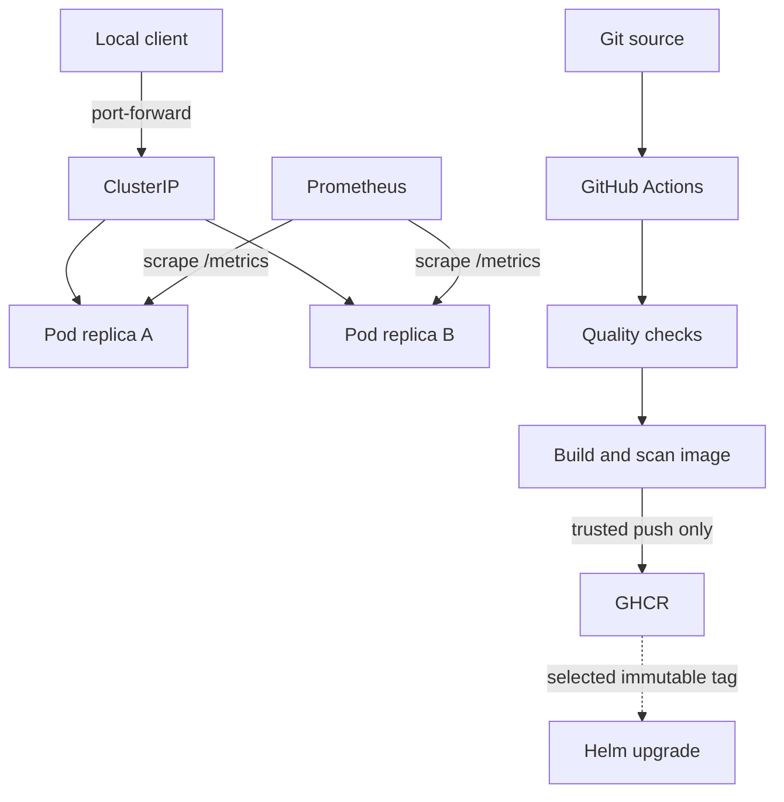

# Architecture

## Components and responsibilities

| Component | Responsibility |
| --- | --- |
| FastAPI / Uvicorn | Small stateless HTTP workload, health, information and Prometheus metrics |
| Docker | Reproducible OCI image with a non-root runtime |
| Compose | Convenient local app run; not a production orchestrator |
| Kind / Kubernetes | Local orchestration and operational exercises |
| Helm | Parameterized Kubernetes packaging and release history |
| GitHub Actions | Test, validate, build and scan; publish trusted commits to GHCR |
| Prometheus / Grafana | Optional metrics collection and local dashboards |

## Request and delivery flows

The cluster is intentionally private to the developer's workstation. `kubectl port-forward` avoids installing an ingress controller in the baseline. The optional ingress directory documents the extension point. NetworkPolicy is applied only when the selected Kind CNI enforces it; upstream Kind's default networking does not enforce Kubernetes NetworkPolicy.

## Security boundaries

The application has no Kubernetes API permissions and runs with a dedicated service account with token automount disabled. Pods run as a fixed non-root UID, drop Linux capabilities, disallow privilege escalation and use a read-only root filesystem. Configuration is non-sensitive. No credentials are checked in. CI uses minimal token permissions and does not publish artifacts from pull requests.

## Deployment lifecycle

Application tests and lint run before image construction. The image tag is a Git SHA or release version. Helm deploys a selected version to the isolated namespace. Readiness gates service traffic; Kubernetes records revisions for rollout inspection and rollback. Prometheus scrapes the app endpoint; logs remain available through container and `kubectl logs` commands.

## Decisions

The app is stateless, so persistent volumes add no value. ClusterIP plus port-forward is enough for local access. Kind offers a local Kubernetes API without cloud spending. Helm provides values-based release management; base manifests remain useful for review. See [ADRs](architecture-decision-records.md).
